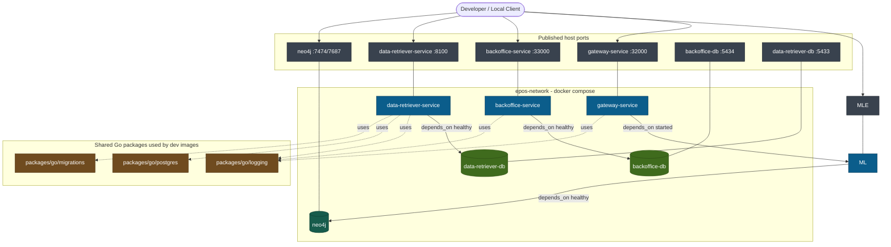

# EPOS Platform

Monorepo for EPOS platform services, shared packages, and local development tooling.

## Current status

The repository currently contains five active backend services used in local development:

- `services/gateway` (Go): API gateway/aggregation layer.
- `services/backoffice` (Go): users, groups, memberships, authorization, and backoffice APIs.
- `services/data-retriever` (Go): templated outbound retrieval, payload caching, and search.
- `services/oss-aai-service` (Go): local authentication and authorization identity provider.

Local infrastructure and service wiring for development are defined in `docker/compose.dev.yaml` and orchestrated by Tilt.

## Architecture (current dev setup)



## Shared Go packages

Shared Go modules live in `packages/go/` and are reused across services.

- `packages/go/logging`: structured JSON logging with component loggers (`logging.Get("component")`).
- `packages/go/postgres`: shared PostgreSQL connection bootstrap from env configuration.
- `packages/go/migrations`: shared `.sql` migration runner (sorted file execution).

## Repository layout

```text
.
|- apps/
|- services/
|  |- gateway/
|  |- backoffice/
|  |- data-retriever/
|- packages/
|  |- go/
|  |- shacl/
|  `- scripts/
|- docker/
|- helm/
`- cli/
```

## Local development

From repository root:

```bash
make up
```

This starts Tilt and the local stack (service + infra containers).

If you are using a Kubernetes-backed Tilt setup, pass the target Kubernetes context explicitly:

```bash
make up KUBE_CONTEXT=kind-epos
```

Common local endpoints:

- Gateway API: `http://localhost:32000`
- Backoffice API: `http://localhost:33000`
- Data Retriever API: `http://localhost:8100`
- OSS AAI API: `http://localhost:8110`
- Neo4j Browser: `http://localhost:7474`

Stop local development stack:

```bash
make down
```

Use the same context when stopping a Kubernetes-backed Tilt stack:

```bash
make down KUBE_CONTEXT=kind-epos
```

## Repository commands

From repository root:

```bash
make up
make down
make test
make fmt
make lint
make populate
make helm-lint
make helm-template
make helm-deploy
make helm-status
make helm-uninstall
```

- `make test|fmt|lint` fan out to all current services.
- Service-specific build and Docker targets stay in each service `Makefile`.
- Helm targets use `helm/epos-platform` by default and can share `KUBE_CONTEXT` with Tilt targets.

## Helm Chart

The platform Helm chart lives under `helm/epos-platform` and deploys the backend services plus optional development datastores:

- `gateway`
- `data-retriever`
- `oss-aai`
- optional PostgreSQL instance for `data-retriever`

Validate the chart locally:

```bash
make helm-lint
make helm-template
```

Deploy or update the chart in the current Kubernetes context:

```bash
make helm-deploy
```

Deploy to a specific context and namespace:

```bash
make helm-deploy KUBE_CONTEXT=kind-epos HELM_NAMESPACE=epos-platform
```

Inspect or remove the release:

```bash
make helm-status KUBE_CONTEXT=kind-epos HELM_NAMESPACE=epos-platform
make helm-uninstall KUBE_CONTEXT=kind-epos HELM_NAMESPACE=epos-platform
```

Useful Helm Make variables:

- `HELM_RELEASE`: Helm release name, default `epos-platform`.
- `HELM_CHART`: chart path, default `helm/epos-platform`.
- `HELM_NAMESPACE`: target namespace, default `epos-platform`.
- `HELM_VALUES`: values file, default `helm/epos-platform/values.yaml`.
- `HELM_SET_ARGS`: additional Helm CLI arguments, such as `--set gateway.image.tag=dev`.
- `KUBE_CONTEXT`: Kubernetes context passed to Helm as `--kube-context` and Tilt as `--context`.

Package the chart locally:

```bash
helm package helm/epos-platform --destination dist
```

For deployments using external datastores, disable the bundled datastore resources and provide connection settings through values:

```bash
make helm-template HELM_SET_ARGS='--set postgresql.dataRetriever.enabled=false --set postgresql.dataRetriever.host=data-retriever-db.example --set neo4j.enabled=false --set neo4j.uri=bolt://neo4j.example:7687'
```

## CI/CD Pipelines

GitHub Actions workflows live under `.github/workflows/`:

- `services-ci.yml`: runs Go/Gradle tests, lint, service builds, Docker image builds, Docker image publishing, and integration tests.
- `helm-ci.yml`: runs Helm lint/render validation, packages the chart, uploads chart artifacts, and attaches release chart packages to GitHub Releases.
- Hurl workflows are currently manual-only because their tests are not correctly implemented.

Pipeline behavior:

- Pull requests validate services, Docker builds, integration tests, and Helm chart rendering without publishing images.
- Branch pushes publish Docker images to GitHub Container Registry using the branch name as the image tag.
- Version tag pushes, such as `v1.2.3`, publish Docker images with both `v1.2.3` and `latest` tags.
- Helm chart packages are uploaded as workflow artifacts for PR, branch, and tag runs.
- Version tag pushes also attach the packaged Helm chart to the matching GitHub Release.

Published Docker image names:

- `ghcr.io/epos-eric/epos-platform/gateway`
- `ghcr.io/epos-eric/epos-platform/data-retriever`

Integration tests start the Docker Compose development stack from `docker/compose.dev.yaml`, wait for the gateway, then run Schemathesis tests against the gateway OpenAPI contract.

TODO: Correctly implement Hurl tests under `tests/hurl/`, then restore automatic CI triggers in `integration-hurl.yml`.

## Service documentation

- Gateway: `services/gateway/README.md`
- Backoffice: `services/backoffice/README.md`
- Data Retriever: `services/data-retriever/README.md`
- OSS AAI: `services/oss-aai-service/README.md`
