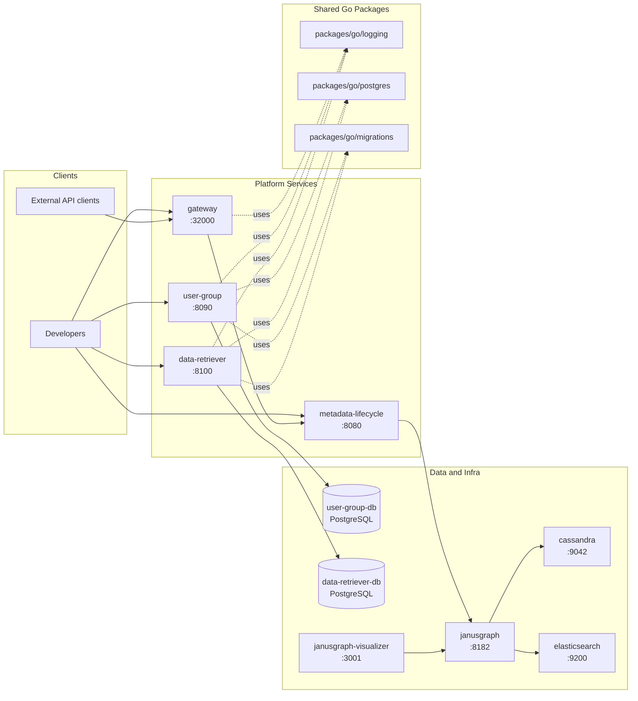

# EPOS Platform

Monorepo for EPOS platform services, shared packages, and local development tooling.

## Current status

The repository currently contains four active backend services used in local development:

- `services/metadata-lifecycle` (Kotlin): metadata lifecycle and versioning APIs backed by JanusGraph.
- `services/gateway` (Go): API gateway/aggregation layer.
- `services/user-group` (Go): users, groups, memberships, and authorization-oriented data.
- `services/data-retriever` (Go): templated outbound retrieval, payload caching, and search.

Local infrastructure and service wiring for development are defined in `docker/compose.dev.yaml` and orchestrated by Tilt.

## Architecture (current dev setup)



## Shared Go packages

Shared Go modules live in `packages/go/` and are reused across services.

- `packages/go/logging`: structured JSON logging with component loggers (`logging.Get("component")`).
- `packages/go/postgres`: shared PostgreSQL connection bootstrap from env configuration.
- `packages/go/migrations`: shared `.sql` migration runner (sorted file execution).

## Repository layout

```text
.
|- apps/
|- services/
|  |- gateway/
|  |- user-group/
|  |- data-retriever/
|  `- metadata-lifecycle/
|- packages/
|  |- go/
|  |- shacl/
|  `- scripts/
|- docker/
|- helm/
`- cli/
```

## Local development

From repository root:

```bash
make up
```

This starts Tilt and the local stack (service + infra containers).

Common local endpoints:

- Metadata Lifecycle API: `http://localhost:8080`
- Metadata Lifecycle Swagger: `http://localhost:8080/swagger`
- Gateway API: `http://localhost:32000`
- User Group API: `http://localhost:8090`
- Data Retriever API: `http://localhost:8100`
- JanusGraph Visualizer: `http://localhost:3001`

Stop local development stack:

```bash
make down
```

## Repository commands

From repository root:

```bash
make up
make down
make test
make fmt
make lint
make populate
```

- `make test|fmt|lint` fan out to all current services.
- Service-specific build and Docker targets stay in each service `Makefile`.

## Service documentation

- Metadata Lifecycle: `services/metadata-lifecycle/README.md`
- Gateway: `services/gateway/README.md`
- User Group: `services/user-group/README.md`
- Data Retriever: `services/data-retriever/README.md`
